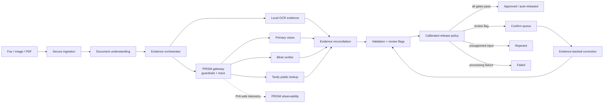

# PillSpark · Fax to Fill

Prescription order workflow demo and OCR benchmark viewer, built with React, TypeScript, Vite, and a Python extraction pipeline.

**Live demo:** https://molgorithmo.github.io/hackathon-nyc/

The GitHub Pages demo includes illustrative prescription workflows and saved OCR benchmark results. It does not run the Python API or accept live uploads. This is an experimental demo, not a clinically validated dispensing system. Benchmark scores measure agreement with upstream references; word-label quality remains unresolved.

## System design

PillSpark converts prescription faxes, scans, photographs, and PDFs into evidence-backed order-entry records. Clear, supported documents can be released automatically; uncertain documents enter an exception workflow; unsupported or non-prescription documents are rejected. Every extracted value retains source evidence, and the system never fills an unreadable value from medical plausibility or catalog matching.



The PRISM gateway is the controlled outbound boundary for hosted model and Tavily calls. It applies PHI-safe request construction, provider allowlists, prompt-injection isolation, output/schema checks, cost and timeout limits, and emits PHI-safe telemetry. The blind verifier never receives the primary answer or OCR/Tavily results.

The backend owns the final `approved`, `confirm`, `rejected`, or `failed` disposition. `approved` means approved for downstream order entry and automatically released; it is not clinical or dispensing approval. `confirm` carries typed review flags such as ambiguous fields, OCR contradiction, low image quality, prescriber conflict, unusual age/dose plausibility, or unavailable/untrusted lookup. Automatic release requires complete required fields, source evidence, independent reading agreement, supported document structure, passing deterministic checks, and calibrated risk within the locked operating range. Unknown checks block release. Corrections create immutable revisions and audit events; the development council is not part of runtime processing.

Server-side Tavily lookups may supply public prescriber or medication-reference evidence, but they never receive patient data, never overwrite extracted values, and never approve a dose. Results are untrusted until checked against an allowlisted authoritative source; ambiguous, stale, contradictory, or unavailable lookups route to `confirm`.

The full problem statement, architecture, API boundaries, revision model, calibration plan, security controls, and build order are documented in [the greenfield system design](context/greenfield-system-design.md). The current implementation history is preserved in the [archived task context](context/archive/2026-10-11/todo-context-legacy.md).

## Run locally

```sh
npm ci
npm run dev
```

For live extraction, follow [Python setup](ocr/README.md), configure the local `.env`, and run `.venv/bin/python -m ocr.api` in a separate terminal. API keys stay on the server. Never commit `.env`, private receipts, or real patient documents.

## Check and build

```sh
npm run lint
npm run test:ui
npm run build
```

## Publish

Push to `main` to deploy via `.github/workflows/pages.yml`. The workflow builds for the repository subpath and publishes only `dist/`. `public/run/` contains the reviewed public benchmark snapshot and selected images; raw model receipts, local jobs, and source datasets remain ignored.

The included benchmark images originate from [ClinOCR-Bench](https://github.com/ClinOCR-Bench/ClinOCR-Bench) (synthetic documents, MIT; [license](data/clinocr/LICENSE)) and [RxHandBD Zenodo v1](https://zenodo.org/records/18478741) (word crops, record declares MIT). See [ClinOCR notes](data/clinocr/README.md) and [RxHandBD notes](data/rxhandbd/README.md) for provenance and limitations.
