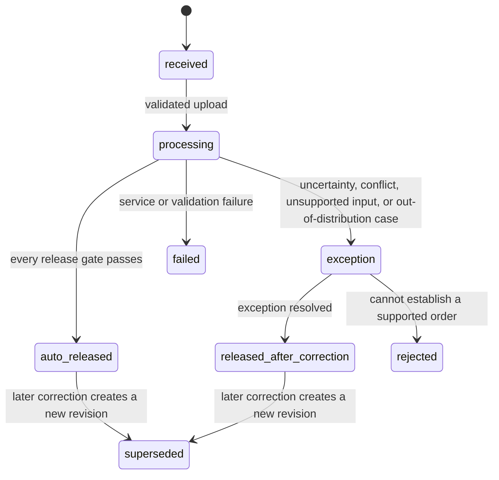

# Fax to Fill: Judge-Ready Target Approach

Status: target architecture. It describes what the hackathon build must become, not what the
current baseline already supports. The model council is advisory; measured results and locked-test
performance decide whether automatic release is enabled.

PillSpark publicly positions its product around automated prescription entry, fax processing,
accuracy at scale, and routing exceptions to the right queue. The product goal here is therefore
straight-through order entry for supported clear cases, not routine per-field confirmation.

References:

- https://pillspark.com/
- https://pillspark.com/blog/ai-agents-data-entry-productivity

## Decision

Use vision-first extraction with independent verification, deterministic rules, and a calibrated
automatic-release gate.

The system automatically releases a structured order when every required field passes the gate.
Cases outside the demonstrated operating range go to an exception path. If no exception workflow
is available, the system rejects those cases rather than guessing.

“Release” means accepting the extracted record for downstream pharmacy order entry. It does not
claim to replace any legally required dispensing verification or clinical appropriateness review.

Do not run the LLM council in the prescription workflow. Do not approve from self-reported model
confidence. Do not require humans to confirm clear fields one at a time.

## Target workflow

There is no routine review state on the happy path. The audit actor for `auto_released` is the
versioned release policy. A later correction never mutates a released order; it creates a new
revision and records why the gate was wrong.

## Runtime pipeline

1. **Ingest:** Decode one JPEG or PNG, enforce size and pixel limits, compute a content hash, and
   reject corrupt or unsupported input before any model call.
2. **Primary extraction:** A vision model reads the original image and returns the strict existing
   field schema with source evidence and explicit ambiguity.
3. **Independent verification:** A second model call independently reads the document without
   seeing the primary answer. It returns the same field contract. Critical fields are always
   verified; automatic release requires verification of every required field.
4. **OCR evidence:** PaddleOCR runs on the original image for tokens, polygons, and image-quality
   signals. OCR never silently fills a field. Enhancement remains outside the default path because
   it worsened the current aggregate OCR result.
5. **Deterministic checks:** Enforce document type, exactly one order, complete required fields,
   nonblank evidence, valid formats, supported layout/input quality, and catalog plausibility.
   Catalogs may reject or flag a value but never manufacture one.
6. **Risk gate:** Compare the two independent readings, their evidence, OCR support, deterministic
   checks, and out-of-distribution signals using thresholds chosen on a separate calibration set.
7. **Route:** Release the record automatically only when all document and field gates pass.
   Otherwise create an exception with machine-readable reasons and all evidence.
8. **Audit/export:** Persist the input hash, model/prompt/policy versions, field evidence, gate
   decisions, and final immutable order revision. Never place document text or images in ordinary
   application logs or observability traces.

The verifier is a targeted safety mechanism, not a majority vote. Agreement helps predict risk but
does not prove correctness.

## Release policy

An order may be automatically released only when all of these are true:

- The document is classified as one supported prescription order.
- Every `APPROVAL_REQUIRED_FIELD` has one nonblank value and source evidence.
- Primary and verifier independently agree after field-specific normalization.
- Neither extractor reports ambiguity, candidates, truncation, or missing evidence.
- OCR and page evidence do not contradict the asserted values.
- Drug, strength, directions, quantity, refills, identity, and date checks pass.
- Image quality and document layout fall inside the calibrated operating range.
- The calibrated field and document risk thresholds pass for the active policy version.
- No service fallback, partial response, or stale model/prompt version occurred.

The policy returns explicit reason codes such as `PRIMARY_VERIFIER_CONFLICT`,
`AMBIGUOUS_STRENGTH`, `UNSUPPORTED_MULTI_ORDER`, `OCR_CONTRADICTION`, `LOW_IMAGE_QUALITY`, and
`OUT_OF_DISTRIBUTION`. It never converts a failed gate into a guessed value.

## Calibration and evaluation

The current ten synthetic non-prescriptions are useful regression tests but cannot calibrate
automatic prescription release. Build a prescription dataset with independent field truth,
evidence locations, ambiguity labels, and order counts. Split by source/template before development
so near-duplicate layouts cannot cross partitions:

- **Development set:** prompts, rules, normalization, and features.
- **Calibration set:** release thresholds only.
- **Locked test set:** one final judge-facing measurement; never used for tuning.

The initial hackathon set can demonstrate the method, but it cannot support a production safety
claim. Report sample counts and uncertainty rather than presenting a small perfect score as proof.

Required metrics:

- Exact whole-order accuracy among automatically released records.
- Critical-field false-accept rate among automatically released records.
- Straight-through coverage: the fraction of supported prescriptions automatically released.
- Exception recall for ambiguity, non-prescriptions, multiple orders, and unreadable inputs.
- Selective-risk curve: observed error as automatic-release coverage increases.
- Reliability curve, Brier score, and expected calibration error if a numeric risk score is used.
- p50/p95 latency and estimated/billed cost per document.

Choose the release threshold on the calibration set. On the locked hackathon test set, the release
gate target is:

- zero observed critical-field false accepts among automatically released records;
- 100% routing of labeled ambiguous, non-prescription, and multiple-order cases to exceptions;
- at least 40% straight-through coverage on supported clear prescriptions;
- a reported 95% confidence bound showing what the sample size does and does not establish.

These are demonstration gates, not universal clinical guarantees. If the error target fails, lower
coverage until it passes or disable automatic release for the failing document/field class.

## Backend contract

The Python backend owns extraction, verification, calibration policy, release, revisions, and
audit history. Nicrron credentials never enter browser code.

- `POST /v1/extractions` - upload one image and start processing.
- `GET /v1/extractions/{id}` - return state, result, evidence, and gate reasons.
- `POST /v1/extractions/{id}/resolve` - resolve an exception against an expected revision.
- `POST /v1/extractions/{id}/release` - release a corrected exception after backend revalidation.
- `GET /v1/extractions/{id}/audit` - return ordered extraction, gate, correction, and release events.

Use SQLite for hackathon state and append-only audit events. Keep source images outside the web root
with a documented retention period. An authorized exception UI may display the source; that is
different from logging or exporting it.

## Smallest implementation path

### 1. Evaluation contract and data

Add positive prescription cases and independent labels before optimizing the pipeline. Extend
`ocr/evaluate.py` to compute whole-order accuracy, critical false accepts, coverage, exception
recall, selective risk, and confidence bounds. Keep the locked test split immutable.

### 2. Independent verification and release gate

Add `ocr/verify.py` for the blind second reading and comparison. Add `ocr/release.py` for pure,
deterministic reason codes, policy versions, threshold evaluation, and state transitions. Test
clear, ambiguous, contradictory, non-prescription, multi-order, truncated, and out-of-distribution
cases without network calls.

### 3. Orchestration and persistence

Add `ocr/pipeline.py` to run primary extraction, verification, and original-image OCR concurrently
where possible. Add `ocr/store.py` for SQLite records, revisions, and events. Preserve raw model
outputs separately from accepted fields.

### 4. API and UI

Add `ocr/api.py` for ingestion, result retrieval, exception resolution, release, and audit. Change
`src/services/extractionService.ts` to call this local backend. The primary UI shows automatic
release with evidence and policy version; detailed editing appears only for exceptions.

### 5. Judge demo

Show three fixed, labeled cases:

1. A clear prescription automatically becomes a structured order without human confirmation.
2. An ambiguous critical value fails the gate, displays both readings and evidence, and cannot be
   released until resolved.
3. A non-prescription or multiple-order document is rejected from straight-through processing.

Then show the locked-test dashboard: coverage, critical false accepts, exception recall,
selective-risk curve, latency, cost, and example failure analysis. Add PRISM tracing only after this
path works, and keep document content out of traces.

## Current evidence, used only as a starting point

The existing dataset has ten synthetic non-prescriptions and zero positive prescription cases.
Vision transcription CER is 20.4%; PaddleOCR original CER is 49.0%; enhancement worsened eight of
ten cases. Seven vision outputs failed schema validation after asserting inappropriate order fields,
and raw document classification was correct on eight of ten cases.

Those results identify failure modes and justify independent verification. They do not set the
target architecture, select the final runtime model, or establish prescription accuracy.
