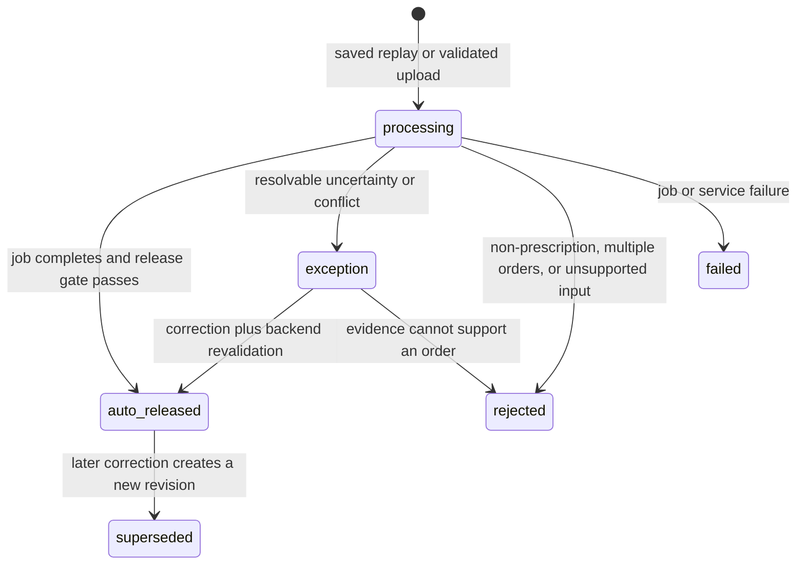

# Fax to Fill: Frontend Approach

Status: saved-case workflows and a separate live image-upload slice are implemented in the repository React application. Live uploads call the local Python extraction API and render its real decisions. Persisted exception correction, measured calibration, and positive-prescription metrics remain open. This document
separates illustrative saved cases from measured pipeline results;
repository behavior, the backend release contract, and locked-test evaluation remain authoritative.

## Implemented snapshot

- **Live upload** accepts JPEG/PNG images and uses the real blind Nicrron pipeline and deterministic gate through `ocr/api.py`. It shows processing/failed states, original-image evidence, exact backend decisions/reasons, and separate readings. It does not expose saved-case correction actions or invent calibrated scores. Unassessed quality/OCR/support/distribution checks continue to block automatic release. The Summary view counts saved cases only.

- `src/App.tsx` provides the single application shell with **Workflow**, **Summary**, and
  **Benchmark** views.
- `src/domain/types.ts` defines the backend-shaped job, release, reason, audit, and workflow envelope
  types. The obsolete human approval types are removed from the happy path.
- `src/services/workflowFixtures.ts` adapts three local cases to the same envelope and validates
  release/order coherence when the module loads.
- The clear prescription is an explicitly illustrative `auto-released` replay with a policy actor,
  evidence, audit events, JSON export, and one low-confidence field that can be corrected through a
  new backend-revalidated revision.
- The ambiguous prescription is an explicitly illustrative `exception` with missing fields and
  calibrated `25 mg` versus `75 mg` candidate scores. It cannot release or export until the
  technician supplies every required correction.
- The non-prescription uses a saved ClinOCR image and hash, returns `rejected`, and renders no order
  fields or export.
- The Benchmark view preserves the existing results viewer and names all required locked-test
  release metrics as unavailable because no positive locked prescription set exists.
- Case switching is derived directly from the clicked case ID, so the image, fields, reasons, and
  decision change together without stale state.
- The queue filters by field-review status. Each extracted value and ambiguous candidate displays
  its own confidence rather than a document-level clear/ambiguous confidence band.
- The ambiguous case lets a technician select `25 mg` or `75 mg`, enter another clarified value,
  fill other missing fields, and send revision 2 for an illustrative backend revalidation replay.
- The Summary view separates automatic releases, technician-assisted releases, pending exceptions,
  and rejections. A correction audit event names the technician; the policy remains the release
  actor.
- The visual system follows PillSpark's public site: white surfaces, dark slate typography, compact
  rounded controls, and a vivid blue primary accent, without external runtime assets or fonts.

## Product job

The frontend makes one decision legible: did the system automatically release a supported order,
route it to an exception, or reject it? It shows the source and evidence behind that decision and
lets a reviewer correct unresolved exceptions and low-confidence fields on released cases.

“Release” means accepting a structured record for downstream order entry. It does not represent
dispensing authorization, clinical appropriateness review, or a claim of production readiness.

## Core interaction principle

Clear, supported prescriptions should not require a pharmacist to confirm ten fields one by one.
The happy path shows the released order, its evidence, the active policy version, and an audit
summary. Detailed editing appears only for exceptions. Missing, ambiguous, conflicting,
multi-order, unreadable, or unsupported inputs never receive a guessed value.

Model confidence is not presented as clinical correctness. The UI may show calibrated gate risk
only after calibration exists, with the metric and policy version named. Until then, it shows
deterministic reason codes and evidence rather than invented percentages.

## Backend state model

The frontend must preserve the distinction between job state and release result:

- Job state is `processing`, `complete`, or `failed`. `processing` and `failed` describe execution,
  not a release-policy decision.
- A completed job contains the exact `ReleaseDecision.status` from `ocr/release.py`:
  `auto-released`, `exception`, or `rejected`.
- A correction that later passes revalidation is still `auto-released`. Record
  `exception-correction` as release provenance and preserve the resolution/release events in the
  audit history. Do not invent a `released_after_correction` status unless the Python contract is
  deliberately extended.



The backend owns these transitions and emits the result envelope. Disabled buttons and local React
state are feedback, not the release control.

## Information architecture

The main workspace uses three stable regions so a judge can understand the result without losing
context:

1. **Case or queue rail:** current state, short reason, and saved demo cases. In a live version this
   becomes the work queue.
2. **Source document:** original image by default, fit/zoom controls, and evidence highlights only
   where genuine locations exist.
3. **Decision panel:** release outcome first, then structured fields, evidence, reason codes, audit
   events, and actions allowed for the current state.

The repository React application has two top-level views: **Workflow** and **Benchmark**. Workflow
renders the job/result envelope. Benchmark reports evaluation evidence. Both live in the existing
`src/App.tsx` application; the project must not maintain the external Ninoo interface as a second
frontend.

## State-specific behavior

### Automatically released

- Lead with the backend result `auto-released`, displayed as `Automatically released`, plus the
  policy actor, policy version, release timestamp, provenance, and immutable revision.
- Show all ten structured fields with source text and available source regions.
- Show why the gate passed without asking for routine per-field confirmation.
- Allow order JSON export and audit inspection.
- A correction starts a new revision, invalidates the active release, and requires backend
  revalidation. It never edits the released record in place. A successful corrected revision is
  still `auto-released`, with `exception-correction` provenance and audit events.

### Exception

- Lead with `Exception` and plain-language blocking reasons mapped from stable backend reason codes.
- Put disputed fields first; keep supported fields collapsed or visually secondary.
- For ambiguity, show every candidate without preselecting one. A reviewer may select a supported
  candidate, enter a value from the source, or reject/request clarification.
- Every correction records the previous value, new value, evidence, actor, time, and resolution
  source.
- Release remains unavailable until the backend returns a releasable current revision.
- In the saved replay, the technician may select a provided candidate or type a value obtained by
  clarification. Date of birth, refills, and technician identity are also required before the
  revision can be sent. The local replay then records the correction and simulates the backend
  policy releasing revision 2; this is explicitly illustrative until the API is connected.

### Rejected

- Explain the rejection reason, such as non-prescription, multiple orders, unsupported type, or
  insufficient evidence.
- Do not render a plausible-looking order from rejected raw model suggestions.
- Preserve a read-only audit/result view for demonstration and diagnosis.

### Failed

- Distinguish service failure from document rejection.
- Offer a bounded retry only when it is safe and idempotent. Never treat a partial response as an
  order.

## Saved-case operational workflow

The demo must work without network access and use three locally bundled, clearly labeled fixtures:

1. **Clear prescription:** until the full pipeline produces a measured positive release, replay an
   illustrative `auto-released` envelope, show the order and evidence, then export its saved JSON.
2. **Ambiguous prescription:** show the `25 mg` versus `75 mg` conflict and keep release blocked.
   The technician may select a candidate after clarification or enter a different corrected value,
   complete the other missing fields, and send revision 2 for illustrative backend revalidation.
   The audit records the technician correction and the separate policy release event.
3. **Non-prescription:** show rejection and no order fields.

The clear and ambiguous prescription SVGs must say
`Illustrative fixture — not measured model output`. They cannot be described as saved model results
until the complete pipeline produces and stores those outcomes. Saved real pipeline results must
name the saved run, policy version, and evaluation split. Simulated delays must not be presented as
live extraction. The current project has no measured positive prescription release case.

Each case owns its source image, result, fields, review state, and outcome. Selecting a case passes
the clicked case ID directly to one transition function and resets all derived state atomically.
The implementation must not set a selected ID and then read the previous React state in the same
handler. Reset restores the selected case's pristine saved state.

## Typed frontend envelope

The typed backend envelope and saved-fixture adapter are implemented. Visual components consume
that envelope; they do not inspect ad hoc fixture shapes or recreate release logic in TypeScript.
The old `confirmed`, `ApprovedOrder`, and `approvedBy` frontend approval model has been removed.
Extraction field statuses remain `extracted`, `needs-review`, or `missing`, matching the extraction
contract rather than representing release authority.

The envelope should express this contract:

```ts
type JobState = 'processing' | 'complete' | 'failed'
type ReleaseStatus = 'auto-released' | 'exception' | 'rejected'
type ReleaseProvenance = 'automatic' | 'exception-correction'

interface WorkflowEnvelope {
  extractionId: string
  inputHash: string
  jobState: JobState
  revision: number
  source: SourceDocument
  categorization: {
    label: 'prescription' | 'non-prescription'
    confidence: 'high' | 'medium' | 'low'
    basis: 'illustrative' | 'saved-result'
    detail: string
  }
  decision: null | {
    status: ReleaseStatus
    policyVersion: string
    documentReasons: ReleaseReason[]
    fieldReasons: Partial<Record<FieldKey, ReleaseReason[]>>
    acceptedOrder: Record<FieldKey, string> | null
  }
  release: null | {
    actor: { type: 'policy'; id: string }
    policyVersion: string
    provenance: ReleaseProvenance
    revision: number
    releasedAt: string
  }
  fields: Partial<Record<FieldKey, ExtractedField>>
  audit: AuditEvent[]
  fixtureEvidence: 'illustrative' | 'measured'
}
```

`decision.status`, reason codes, and accepted-order nullability must match `ReleaseDecision` in
`ocr/release.py`. The policy actor replaces `approvedBy` for automatic release. Human identity
belongs only on exception correction events. A release records the system policy actor, policy
version, revision, release time, provenance, and reason codes.

Minimum backend-owned data for a rendered result:

- extraction ID, input hash, job state, revision, and timestamps;
- source-document reference suitable for authorized display;
- primary and verifier model/prompt versions;
- release-policy version and document/field reason codes;
- structured fields with status, source text, candidates, and optional evidence locations;
- exact release status and immutable accepted order only for `auto-released`;
- system policy actor, version, release time, provenance, and revision for each release;
- ordered audit events and allowed next actions.

The eventual service should call the extraction, result, exception-resolution, release, and audit
endpoints defined in `context/end-to-end-approach.md`. Credentials and release decisions never
enter browser-only code.

## Judge-facing metrics

The Benchmark view must expose locked-test results needed to assess the release gate:

- exact whole-order accuracy among `auto-released` records;
- critical-field false accepts among `auto-released` records;
- straight-through coverage;
- exception recall, including ambiguous and unsupported cases;
- sample count and split provenance;
- confidence bounds appropriate to the observed counts;
- a selective-risk curve showing observed release error as coverage changes.

Until positive prescriptions and a locked test set exist, render these metrics as unavailable with
the blocking evidence gap. Do not substitute ClinOCR character error rate or illustrative fixture
behavior for release accuracy.

## Field-level confidence

Technicians filter the queue by whether any fields require review. Each extracted value and each
candidate option carries its own calibrated confidence score. Values below the UI review threshold
of `0.85`, missing values, and ambiguous candidate sets display `Review`; low-confidence extracted
values also expose an edit action.

Technician-supplied values display `Technician confirmed` because they are not model extractions.
The current scores are evaluation fixture values that demonstrate the frontend contract, not
measured calibration evidence. When the live API is connected, the backend must supply versioned
calibrated field and candidate scores; the frontend must only format and threshold them.

## Release summary terminology

The Summary view reports two release paths:

- **Automatic release:** the policy released revision 1 without technician correction.
- **Technician-assisted release:** a technician corrected an exception and the policy released a
  later revision after revalidation.

The UI does not call the second path “technician approved.” The technician owns the correction and
is named in its audit event; the backend policy owns the final release. Pending exceptions and
rejections are counted separately.

## Presentation and accessibility

- Fit a 1366 by 768 judge laptop without horizontal page scrolling.
- Keep long values, evidence, errors, and JSON readable with normal wrapping and internal vertical
  scrolling. Do not clip safety-relevant text or squeeze it into narrow metadata columns.
- Use visible focus, semantic headings, labeled controls, and status text that does not rely on
  color alone.
- Keep the source and active decision visible together; stack them at narrow breakpoints.
- Use restrained status colors: teal for released, amber for exception, red for rejected/failed,
  and neutral styling for unassessed information.

## Acceptance status

Verified in the implemented saved-case slice:

- Switching Clear to Ambiguous immediately changes the image, title, fields, candidates, reason
  codes, and outcome; Ambiguous to Non-prescription does the same.
- The clear saved replay starts automatically released without ten confirmation clicks.
- The ambiguous case remains an exception, exposes both strength candidates, and has no order
  export until all required corrections are supplied.
- Selecting `25 mg` or `75 mg`, or entering a custom strength, plus the other required values enables
  `Send for backend approval`; the replay creates revision 2 with correction and release events.
- The non-prescription renders no order fields and has no export.
- Field-review filtering shows cases with unresolved, missing, or low-confidence values and
  immediately selects a visible case.
- A low-confidence field on the clear prescription displays `Review`, its calibrated percentage,
  and an edit action. Submitting a correction creates revision 2 and a technician audit event.
- The Summary view updates from one pending exception to one technician-assisted release after the
  ambiguous replay is resolved, while the clear case remains an automatic release.
- Reset returns to deterministic clear-case state; cases do not inherit one another's state.
- All three source assets are distinct, local, and usable without runtime model calls.
- At 1366 by 768 there is no horizontal page overflow or overlapping field text.
- Production build, lint, viewer export tests, and browser console checks pass.

Remaining acceptance work:

- Replace the illustrative local exception transition with API-backed correction, expected-revision
  checks, and backend revalidation.
- Connect released-field corrections to the API with expected-revision checks while preserving the
  prior immutable release in backend audit history.
- Exercise real `processing` and `failed` API states, timeouts, retries, and stale revisions.
- Validate keyboard navigation and the narrow breakpoint as a dedicated accessibility pass.
- Populate locked-test metrics and the selective-risk curve from independently labeled positive
  prescriptions.

## One-frontend boundary

The repository React application in `src/App.tsx` is the only implementation target and now
contains Workflow and Benchmark views. The external Ninoo interface is not maintained or shipped
as a second frontend.

The Workflow view consumes saved envelopes; Benchmark consumes exported saved results. Live upload
uses POST/GET extraction endpoints and private persisted job/receipt files. Live correction, production
authentication, source-image persistence, and a dedicated audit API remain outstanding. The backend
is the live decision authority; browser-generated audit summaries are read-only views of returned job timestamps and decisions.

## Implementation order

Completed:

1. Replace the transitional human approval model with the typed workflow envelope matching
   `ReleaseDecision` and a fixture adapter that produces the same shape.
2. Make the saved replay truthful and deterministic with distinct local fixtures, atomic case
   switching, correct outcomes, offline assets, and no fabricated confidence.
3. Extend `src/App.tsx` with Workflow and Benchmark views that render
   `auto-released`/`exception`/`rejected` decisions from saved envelopes.
4. Add the locked-test metric contract and truthful unavailable states before positive evaluation
   data exists.
5. Add categorization-confidence filtering, candidate/custom technician correction, local revision
   and audit replay, and an automatic-versus-technician-assisted Summary view.
6. Align the native application with PillSpark's public visual language using offline-safe styles.

Next:

7. Extend the implemented read-only result endpoint with persisted correction audit events.
8. Replace local exception resolution with API-backed expected-revision checks, backend
   revalidation, and persisted correction audit.
9. Extend implemented image upload/processing with persisted revisions and exception correction;
   preserve existing file validation, idempotency, release policy, and private-receipt boundaries.
10. Populate locked-test release metrics and calibrated categorization bands from independently
   labeled prescriptions.
11. Rehearse the three saved cases at judge resolution and retain the replay as the fallback for any
   live-service failure.
