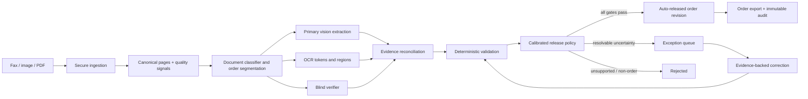

# PillSpark Fax to Fill: Greenfield System Design

This document starts from the problem rather than the current repository. Existing code can be
reused later only when it fits this design.

## Problem statement

Pharmacies receive prescriptions as faxes, scans, and photographs. These documents may be blurry,
rotated, handwritten, incomplete, or contain several medications. Staff must read them and enter
patient, prescription, and prescriber data into an order-entry system. Manual entry creates delay
and cost, while an incorrect drug, strength, directions, quantity, or patient identity can create
serious downstream risk.

Build a system that converts an incoming prescription document into a structured order-entry
record, automatically accepts clear and supported extractions, routes only uncertain cases to an
exception workflow, and rejects documents that cannot safely enter the workflow. Every accepted
value must be tied to visible source evidence. The system must never fill an unreadable value from
medical plausibility, model agreement, or a drug catalog.

In this design, **release** means accepting the extracted record for downstream pharmacy order
entry. It does not replace clinical appropriateness review, patient counseling, controlled-
substance requirements, or any dispensing verification required by law or organizational policy.

### Required input

- One fax image, photograph, or multi-page PDF.
- JPEG, PNG, TIFF, or PDF with explicit file-size, page-count, and pixel limits.
- A tenant and authenticated user or source-system identity.

### Required output

- Document classification and number of prescription orders.
- One structured record per order: patient name, date of birth, drug, strength, dosage form,
  directions, quantity, refills, prescriber, and written date.
- Source page and bounding region for every extracted field.
- Field state: supported, missing, ambiguous, conflicting, or invalid.
- Document decision: `auto_released`, `exception`, `rejected`, or `failed`.
- Versioned reason codes, model and policy provenance, and an immutable audit history.

### Product success criteria

- Clear prescriptions do not require routine per-field confirmation.
- No critical field is silently guessed or selected from conflicting candidates.
- Automatic-release coverage is maximized subject to an agreed upper bound on critical-field false
  acceptance, measured on a locked prescription test set.
- Exceptions explain exactly what prevented release and show the relevant evidence.
- Corrections create a new revision; they never mutate an already released order.

## System design

## 1. Operating principle: selective automation

The system has two paths:

1. **Straight-through path:** a supported single-order prescription passes all extraction,
   evidence, validation, independence, calibration, and policy checks. The backend automatically
   releases the structured record.
2. **Exception path:** any missing, ambiguous, conflicting, unreadable, unsupported, or
   out-of-distribution condition creates an exception. A technician corrects the evidence-backed
   value or requests clarification. The backend revalidates the new revision and remains the
   release authority.

Non-prescriptions, unsupported multi-order layouts, and documents without enough evidence are
rejected rather than converted into plausible-looking orders.

## 2. Runtime architecture



### A. Secure ingestion

- Authenticate the sender, enforce tenant isolation, and assign an idempotency key.
- Validate actual file bytes, MIME type, page count, dimensions, and decompression limits before
  any model call.
- Store the encrypted original in private object storage and compute a content hash.
- Render PDFs to canonical page images without replacing the original evidence.
- Create a job record and return immediately; workers process asynchronously.

### B. Document understanding

- Classify each page as prescription, non-prescription clinical document, cover sheet, or unknown.
- Detect whether the document contains zero, one, or multiple explicit orders.
- Segment multi-page documents and associate continued pages with the same order.
- Reject unsupported layouts explicitly. Never choose one medication from a multi-order page unless
  order segmentation has been independently validated.

### C. Three independent evidence lanes

1. **Primary vision extractor:** reads the original page and returns the strict field schema,
   verbatim source text, candidates, and evidence regions.
2. **OCR lane:** produces tokens, native scores, polygons, orientation, blur, contrast, and
   handwriting/print signals. OCR supplies independent evidence but cannot overwrite a field.
3. **Blind verifier:** reads the original page without receiving the primary answer, OCR text,
   drug catalog results, or prompt examples from evaluation cases. Automatic release requires a
   complete verifier reading of every required field.

Primary extraction and OCR run in parallel. The verifier runs for every potential prescription;
obvious non-prescriptions can be rejected before the second paid call only when the classifier's
rejection policy has been independently validated.

### D. Reconciliation and deterministic validation

The backend converts all model output into one internal schema, then evaluates:

- required-field completeness and nonblank evidence;
- document type and exactly-one-order support;
- conservative, field-specific agreement between primary and verifier;
- OCR contradictions and evidence-region overlap;
- date, quantity, refill, identifier, and unit syntax;
- drug/strength/form catalog plausibility, used only to flag or reject, never to invent a value;
- image-quality and supported-layout limits;
- stale model, prompt, schema, policy, or cross-document receipt mismatches;
- out-of-distribution signals based on the labeled operating range.

The validators return stable field and document reason codes. They do not directly mutate the
extracted values.

### E. Calibrated release policy

The release service is a pure, versioned backend function. It receives validated readings,
evidence features, and calibrated risk estimates and returns exactly one decision:

- `auto_released`: all required values and evidence exist; independent readings agree; every
  deterministic check passes; each field and the document are within the calibrated operating
  range; an immutable accepted order is created.
- `exception`: the document is a potentially valid prescription but contains a resolvable missing,
  ambiguous, conflicting, low-quality, or out-of-distribution condition. No accepted order exists.
- `rejected`: the input is not a prescription, contains an unsupported order structure, or cannot
  be supported from the source. No accepted order exists.
- `failed`: processing did not produce a complete decision because of infrastructure, model, or
  schema failure.

Model confidence and model agreement are features, not approval rules. Unknown checks always block
automatic release.

## 3. State and revision model

```text
received -> processing -> auto_released
                       -> exception -> auto_released after corrected revision
                                    -> rejected
                       -> rejected
                       -> failed

auto_released -> superseded by a new revision
```

An exception reviewer supplies a correction and its source: visible document evidence, prescriber
clarification, or an allowed external source. The correction creates revision `n+1`, records the
actor and before/after values, and reruns deterministic validation and the release policy. The
technician corrects evidence; the policy releases the record.

## 4. Core data model

- `DocumentJob`: tenant, job ID, input hash, encrypted source reference, job state, timestamps.
- `ModelReceipt`: role, model, prompt/schema versions, input hash, provider request ID, completion
  state, latency, and usage. Raw output remains private.
- `FieldReading`: key, verbatim value, normalized comparison value, source text, page/region,
  candidates, status, and producer.
- `EvidenceSignal`: OCR support, quality, layout support, catalog check, OOD result, and provenance.
- `ReleaseDecision`: policy version, status, document reasons, field reasons, accepted order ID.
- `OrderRevision`: immutable structured values, source job, revision number, release provenance.
- `AuditEvent`: actor, action, timestamp, expected revision, before/after hashes, and reason.

## 5. API boundaries

- `POST /v1/documents` — upload and create an idempotent processing job.
- `GET /v1/documents/{id}` — job state, safe result envelope, and allowed actions.
- `GET /v1/documents/{id}/source` — short-lived authorized source-page access.
- `GET /v1/documents/{id}/audit` — ordered immutable events.
- `POST /v1/documents/{id}/resolve` — evidence-backed corrections with expected revision.
- `POST /v1/documents/{id}/reject` — explicit exception rejection.
- `GET /v1/orders/{id}` — released immutable revision.
- `POST /v1/orders/{id}/correct` — create a superseding revision; never edit in place.
- `GET /v1/orders/{id}/export` — downstream JSON/FHIR-style adapter output as required.

The browser never receives provider credentials, raw provider responses, or unrestricted source
URLs. The API never accepts a client claim that a safety check passed.

## 6. User experience

### Straight-through result

Show the released order, source evidence, policy version, release time, and audit summary. Do not
ask the user to confirm every field.

### Exception workspace

Show disputed fields first, with the original source crop, primary reading, verifier reading, OCR
evidence, candidates, and plain-language reason. Do not preselect a candidate. Require a resolution
source and expected revision on submission.

### Rejected or failed input

Do not display a plausible order. Explain whether the document was rejected by policy or processing
failed, and provide only safe, idempotent retry actions.

## 7. Calibration and evaluation

Create independently adjudicated full-prescription labels with field values, evidence regions,
legibility, ambiguity, document type, and order count. Split by pharmacy/source, fax template,
prescriber, and writer so related documents cannot cross splits:

- **Development:** prompts, schemas, normalizers, validators, and feature design.
- **Calibration:** fit field/document risk models and select release thresholds.
- **Locked test:** one judge-facing measurement, never used for tuning.

Report:

- exact whole-order accuracy among automatically released records;
- critical-field false accepts among automatically released records;
- straight-through coverage;
- exception recall by ambiguity, conflict, unreadability, non-prescription, and multi-order class;
- selective-risk curve as coverage changes;
- calibration reliability and Brier/ECE when numeric risks are shown;
- sample count and confidence bounds;
- p50/p95 latency, failure rate, and cost per document;
- corrected-exception performance separately from automatic performance.

Choose thresholds on the calibration set to maximize coverage while satisfying the agreed
critical-error bound. If the locked test fails, reduce coverage or disable the failing document
class. Never tune on the locked test.

## 8. Privacy, security, and observability

- Encrypt documents and derived artifacts in transit and at rest.
- Enforce tenant-scoped authorization, least privilege, authenticated source access, retention, and
  deletion policies.
- Keep PHI, raw images, transcriptions, field values, and image hashes out of ordinary logs and
  external traces.
- Maintain access, decision, correction, export, and deletion audit events.
- Require appropriate agreements and data-handling terms for every model or storage provider used
  with real PHI.
- Send PRISM operational metadata only: model role/version, timing, token usage, validation state,
  aggregate field-status counts, decision, and stable reason codes. PRISM failure cannot alter the
  release decision.

These controls align with the HHS Security Rule's emphasis on access control, audit controls,
integrity, authentication, and transmission security, and with NIST AI RMF guidance on documented
measurement, monitoring, and accountable go/no-go decisions.

## 9. Deployment shape

- React web application behind authenticated access.
- Stateless API service for ingestion, results, corrections, and exports.
- Queue plus isolated worker pool for rendering, OCR, and model calls.
- Private object storage for originals and evidence crops.
- Relational database for jobs, revisions, decisions, and audit events.
- Secrets manager for provider credentials.
- Version registry for schema, prompts, models, validators, calibrators, and release policies.
- Metrics and PHI-safe tracing separated from private clinical artifacts.

## 10. Build order

1. **Truth before models:** finalize the order schema, reason codes, labeling guide, and independently
   labeled development/calibration/test splits.
2. **One vertical slice:** one image through validated upload, primary extraction, stored evidence,
   deterministic decision, and read-only UI using fake providers in tests.
3. **Independent evidence:** add OCR and blind verifier receipts bound to the same image hash.
4. **Release and exception policy:** implement the pure gate, revision model, corrections, and audit.
5. **Calibrate:** fit risk models, select thresholds on calibration data, freeze the policy, and run
   the locked test once.
6. **Judge workflow:** demonstrate one measured auto-release, one measured exception corrected into
   a new revision, one measured rejection, and the locked-test coverage/error dashboard.
7. **Production hardening:** authentication, tenant isolation, retention/deletion, vendor review,
   monitoring, rollback, and operating procedures.

## Explicit non-goals

- No runtime LLM council or majority vote.
- No catalog-driven reconstruction of unreadable text.
- No automatic release based only on self-reported confidence or two-model agreement.
- No routine human confirmation for supported clear prescriptions.
- No claim of clinical or production readiness before locked-test and operational validation.

## References

- HHS, Summary of the HIPAA Security Rule: https://www.hhs.gov/hipaa/for-professionals/security/laws-regulations/index.html
- NIST, AI Risk Management Framework: https://www.nist.gov/itl/ai-risk-management-framework
- NIST AI RMF Measure playbook: https://airc.nist.gov/airmf-resources/playbook/measure/
